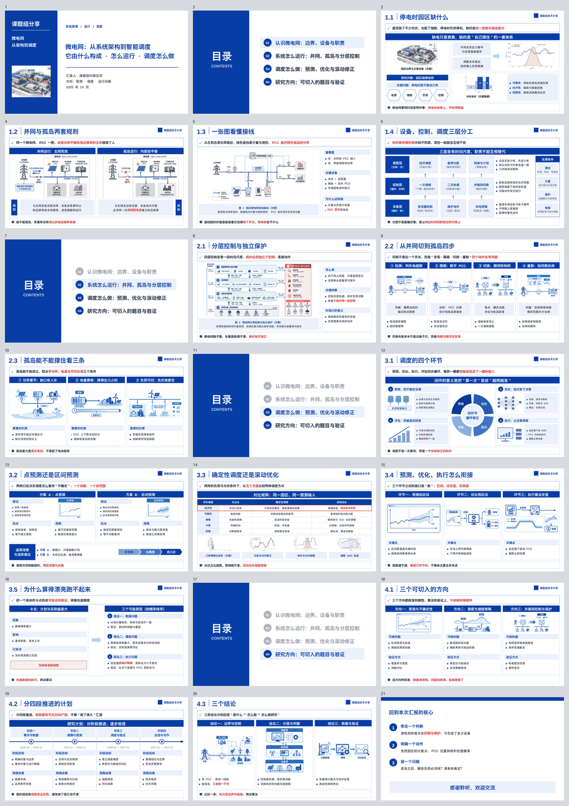
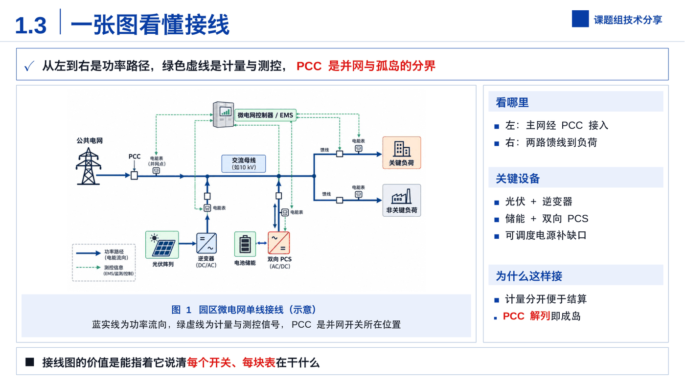
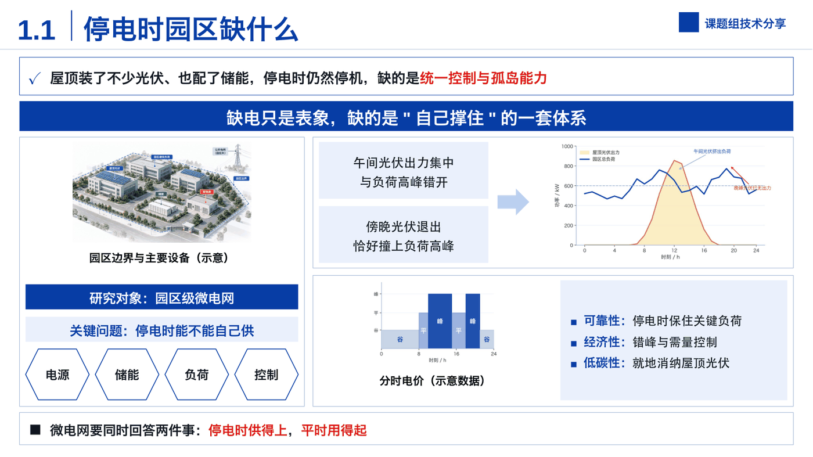
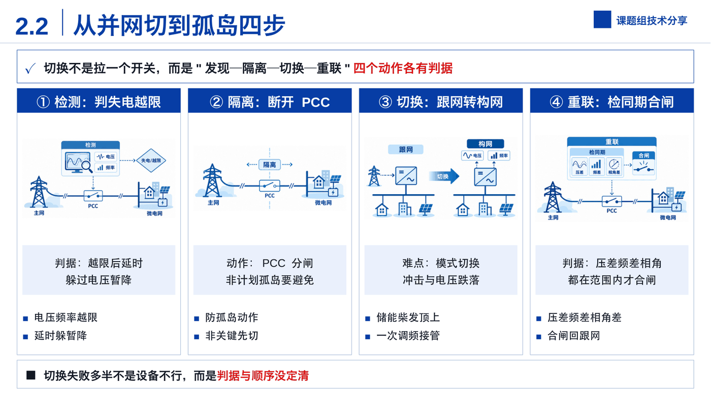
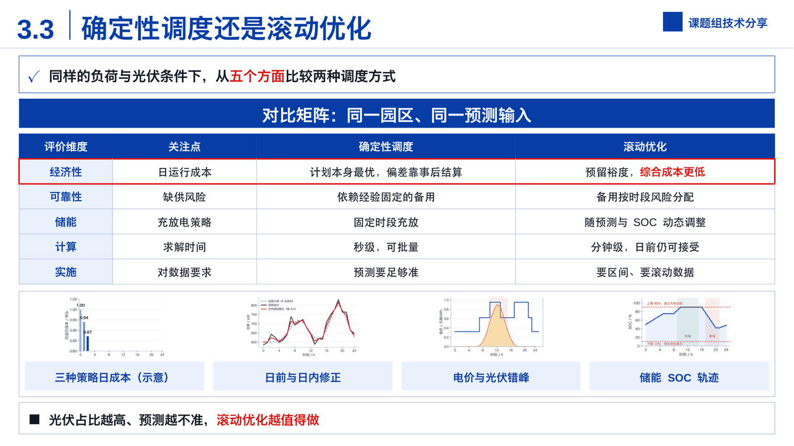
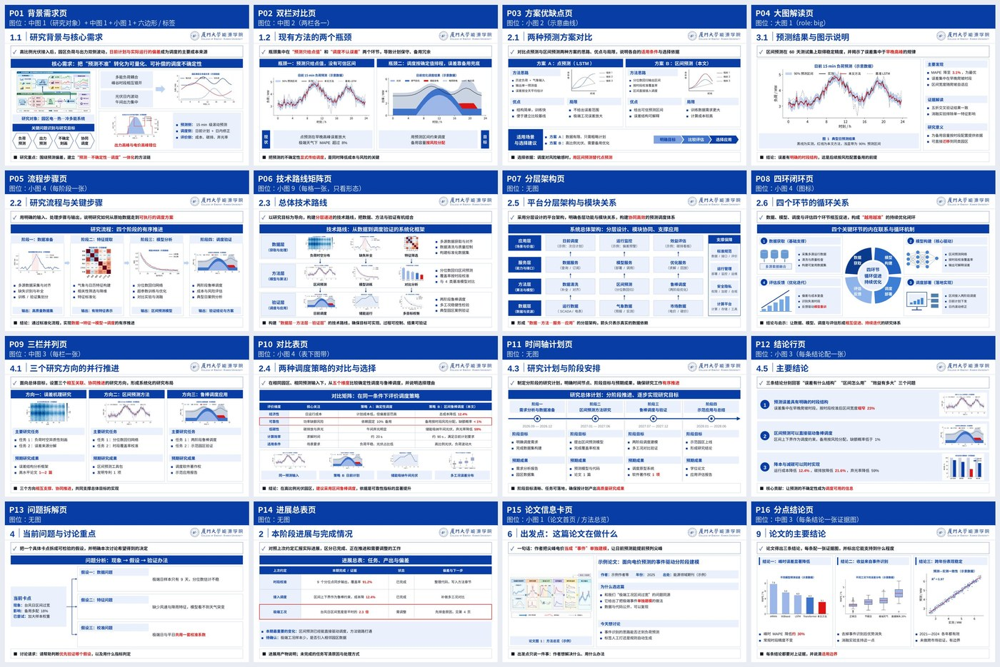

# 科研场景 PPT Skill · 蓝白信息图式

**给 AI agent 的一份 PPT 技能包：说清主题、把材料丢给它，产出是一份原生可编辑的 PPTX + 逐字稿 + 全稿预览。**

不是"AI 画一张图塞进幻灯片"——文字、表格、流程、矩阵都是真对象，打开 PowerPoint 就能改。

`MIT` · `python-pptx` · `16 个推荐页型` · `22 种版式` · `逐页渲染核对`

---

## 先看东西

### 一份 21 页的成品，全部由本仓库生成

微电网技术分享：封面、4 次目录过渡、18 个内容页、结束页。**整份稿子从一份内容 JSON 生成，没有手工排版。**



### 四页细节（点开看原尺寸）

**① 大图解读页**——一张接线图占七成版面，右侧三小节讲"看哪里 / 关键设备 / 为什么这样接"。图要看得清，字不许糊。



**② 信息密度页**——场景图 + 典型日曲线 + 分时电价 + 三条判断，一页塞满但不乱；留白靠内容填，不靠放大字号。



**③ 四栏并列页**——四个动作各配一张插画、一个判据框、两条要点；上面一条蓝带写明这页只讲一件事。



**④ 对比表页**——表头深蓝、首列浅蓝、关键数字标红、整行加红框，下面压一条四张小图的证据带。



### 16 个页型，选一个就能开工



---

## 为什么值得一试

| 手工做一份组会 PPT | 用这个 |
|---|---|
| 版式每页现编，做三份三套长相 | 16 个页型 + 22 种版式，同一套视觉语言 |
| 调字号、对不齐、图片被压扁 | 字号与间距写死在脚本里，按内容自动收放，从不上放大字号 |
| 空半页，于是把字放大 | 留白用图、小标题要点、流程条、表格填 |
| 讲稿单独再写一遍 | 每页 `notes` 一起产出，直接导出 Word 逐字稿，还带预计时长 |
| 溢出、孤行、红字泛滥，靠肉眼找 | `lint.py` 自动查：溢出、孤行、拆词、红字数量、编号跳号、免责字样 |
| 交出去才发现第 12 页图糊了 | 逐页渲染成图核对，交付前必须看过 |

---

## 30 秒上手

```bash
git clone https://github.com/d2dmh/research-ppt-skill.git \
  ~/.hermes/skills/productivity/research-ppt-skill
```

装完对 agent 说一句话就行：

> 用 research-ppt-skill 做一份《XX 的组会汇报》，材料在 xxx.docx，20 分钟。

它会先问清场合、听众、时长、署名和素材，再给一份逐页大纲（每页标页型与大 / 中 / 小图位），然后生成 → 自检 → 渲染看图 → 交 PPTX、讲稿和预览。

**Claude Code / Codex / 其他 agent**：把整个目录放到它读得到技能的位置，或在会话里说"读 `research-ppt-skill/SKILL.md`，按它执行"。

---

## 一页是怎么搭出来的

每一页从上到下就这五层，所以整份稿子读起来是同一个节奏：

| 层 | 内容 | 作用 |
|---|---|---|
| ① 页标题 | `2.3 ｜ 孤岛能不能撑住看三条` | 告诉听众这页讲什么 |
| ② ✓ 引导句 | 一句话交代背景与条件 | 进入这页的语境 |
| ③ 深蓝标题带 | **这页的一句话判断** | 全页只讲这一件事 |
| ④ 图文区 | 图 + 浅蓝小标题条 + ■ 要点 / 矩阵 / 流程 / 表格 | 证据和分点 |
| ⑤ ■ 结论条 | 落脚点，红字点睛（一页 ≤ 4 处） | 听众带走的那句 |

配色与字号是从《蓝白科研答辩模板》实测参数抠出来的，不是估的：深蓝 `#073DA5`、正文 `#111722`、强调红 `#DE1515`、细边框 `#9CB3D3`、浅蓝 `#EAF0FC`；页标题 32 pt、标题带 20.4 pt、要点 14.4 pt。

---

## 16 个页型

大纲阶段先定页型，再从骨架起步，不要每页现编。骨架在 `assets/page-types.json`，按编号取 `skeleton`，只换文字和图。

| 页型 | 用在哪 | 图位 |
|---|---|---|
| P01 背景需求页 | 研究背景、现实需求、研究对象 | 中图 1 + 中图 1 + 小图 1 |
| P02 双栏对比页 | 两个瓶颈、两种现状、前后对比 | 中图 2 |
| P03 方案优缺点页 | 两种方法 / 方案的选择 | 小图 2 |
| P04 大图解读页 | 论文框架、技术总图、核心结果 | 大图 1（`role: big`） |
| P05 流程步骤页 | 研究流程、方法步骤、实施过程 | 小图 4 |
| P06 技术路线矩阵页 | 数据层 / 方法层 / 验证层 | 小图 9 |
| P07 分层架构页 | 系统 / 平台架构、模块关系 | 无图 |
| P08 四环闭环页 | 四个环节的循环、迭代机制 | 小图 4 |
| P09 三栏并列页 | 三个方向、三项任务、三条结论 | 中图 3 |
| P10 对比表页 | 多维对比、方案选择、效益汇总 | 小图 4（表下图带） |
| P11 时间轴计划页 | 研究计划、阶段安排 | 无图 |
| P12 结论行页 | 主要结论、创新点、预期成果 | 小图 3 |
| P13 问题拆解页 | 当前卡点、讨论重点 | 无图 |
| P14 进展总表页 | 组会进展、任务完成情况 | 无图 |
| P15 论文信息卡页 | 文献汇报的出发点 | 小图 1 |
| P16 分点结论页 | 文献 / 结果的三条结论 | 中图 3 |

`references/outline.md` 里是把这些页型交给网页端 GPT 的大纲提示词：每页标页型编号、大 / 中 / 小图位、分点内容，拿回来就能直接填骨架。

---

## 风格库

**目前发布 1 种风格，正在加别的。** 每个风格是一套独立的配色 / 字号 / 版式实现，内容 JSON 与流程不变，换风格只换"皮"和排版规则。

| 风格 | 状态 | 长什么样 | 适合 |
|---|---|---|---|
| **科研风 · 蓝白信息图** | ✅ 已发布 | 深蓝标题带 + ✓ 引导句 + 浅蓝小标题条 + ■ 结论条 | 答辩、开题、中期、组会、文献汇报、技术分享 |
| 商务极简风 | 🧭 规划中 | — | 项目汇报、方案评审、对外合作 |
| 深色技术风 | 🧭 规划中 | — | 技术分享、产品发布、大屏演示 |

想要哪种风格，开个 issue 说清**场景和听众**（"给甲方讲方案，30 页，要稳"）——按场景加比凭空设计有用得多。

想自己加：当前风格实现在 `scripts/info_style.py`，注册与调用规则在 `SKILL.md`；新增风格 = 新写一个 style 脚本 + 在 SKILL 里加一节，页面骨架与组件接口可以复用。

---

## 配图分工

| 图的用途 | 谁画 |
|---|---|
| 概念、流程、角色、状态（检测 / 隔离 / 切换 / 重联、边界、三层、数据流、充放电……） | 网页端 ChatGPT，蓝白扁平风，一次 8–9 张、每张独立 |
| 定量对比（成本高低、SOC 轨迹、误差分布、日负荷曲线） | 本机 matplotlib，图注写"示意数据" |
| 系统架构 / 单线接线 / 分层控制 | 网页端 ChatGPT，一页一张大图 |

贴图前三条硬规则：要读的标签 ≥ 3 个就给到 3.5 in 宽（放不下换三栏 / 四栏，别缩图）；插画自带的标题条要裁掉；交付前降采样到 1200 px + 量化 200 色（16 MB 的稿子能压到 11 MB）。

---

## 会给你哪些文件

| 产物 | 说明 |
|---|---|
| 原生可编辑 PPTX | 文本框、表格、图形、流程、矩阵都能在 PowerPoint 里直接改 |
| Word 逐字稿 | 每页一段口语化讲稿，附每页预计时长 |
| PDF + 联系表 | 一次看全稿，手机上也能翻 |
| 检查报告 | `lint.py` 的溢出、孤行、拆词、红字、编号、免责字样清单 |
| 交付说明 | 图文来源、示意数据边界、改稿方法（md + docx） |

---

## 质量是怎么保证的

生成 → 自动检查 → 渲染成图逐页看 → 改 → 再生成。这不是"跑一遍就交"的脚本：

- **生成日志**：`over-full`（分区溢出）、`has empty`（下方空了）、"小图太小看不清"、"一页放了两张大图"、"高亮词不在正文里"——先清零再往下走。
- **`lint.py`**：溢出、孤行、拆词、红字数量、编号跳号、AI 免责字样、图片占位残留。目标是 0 错误 0 警告。
- **逐页渲染**：脚本查不出"分区里空了一块""图在格子里太小"，只能看图发现。
- **终稿**：PowerPoint 里播一遍确认断行（LibreOffice 预览是替代字体）。

---

## 安装与依赖

```bash
# Hermes Agent
mkdir -p ~/.hermes/skills/productivity
cp -R research-ppt-skill ~/.hermes/skills/productivity/

# Python 依赖
pip install python-pptx python-docx lxml Pillow
# 可选
pip install jieba            # 断词检查
pip install PyMuPDF          # 渲染预览
# 渲染还需要 LibreOffice（soffice 在 PATH 里）
```

详细步骤、各平台的坑见 [`INSTALL.md`](INSTALL.md)。

---

## 目录结构

```
SKILL.md                 # 给 agent 的操作手册：流程、规则、踩坑清单、自检
INSTALL.md               # 安装与依赖
references/
  outline.md             # 交给网页端 GPT 的大纲提示词（页型编号 + 大中小图位）
  info-style.md          # 视觉规范、组件、22 种版式、"要讲的事 → 版式"对照
  visuals.md             # 配图来源、提示词写法、取回核对
  speaker-notes.md       # 讲稿规则
  embedded-video.md      # 录屏页真内嵌 mp4
scripts/
  dense_deck.py          # 内容 JSON → PPTX
  info_style.py          # 科研风：页面骨架、组件、版式
  lint.py / render.py    # 检查 / 渲染
  prep_figs.py           # 缺图 → 占位框 + 提示词
  insert_image.py        # 往占位框填图
  notes_docx.py          # 讲稿 → Word
  delivery_doc.py        # 交付说明 md → docx
  embed_video.py         # 内嵌 mp4
assets/
  page-types.jpg/.json   # 16 个推荐页型：总览图 + 可套用骨架
  info-demo.json         # 28 页示例（答辩 / 开题）
  scenes-demo.json       # 19 页示例（组会 / 文献 / 竞选 / 活动）
  images/ components/    # 示例数据图与可复用图标
  branding/              # 默认机构标识（请替换成你自己的）
docs/                    # README 用的预览图
```

---

## 已知边界

- **生成后仍要逐页看图**：脚本保证规范和字号，版面饱不饱满、图够不够大得靠眼睛。
- **配图要另外准备**：要么你给论文原图 / 数据，要么让网页端 GPT 画；缺图时先生成占位框和提示词。
- **定量图不放真实数据就只能是示意**：图注必须标"示意数据"，正式稿请换成实测值。
- **`assets/branding/xmu-*.png` 是作者的默认机构素材**，用之前换成你的单位标识。

---

## 如果它帮你省了一个晚上

点右上角的 **⭐ Star**——这是让更多做汇报的人搜到它的唯一办法；顺手转给还在手搓幻灯片的同门和同事。

有需求也欢迎开 issue：说清**场景、听众、页数**，我按场景加页型或风格。想看别人的用法，也可以在 issue 里贴你生成的稿子。

---

## English

**research-ppt-skill** — a skill package for AI agents that produces **native, editable** research decks in one consistent blue-and-white infographic style: page title → ✓ lead sentence → navy title band stating the page's single message → dense figure-and-bullet area (tech-route matrices, layered architectures, cycles, timelines, comparison tables) → ■ takeaway bar.

Say the topic and hand over your material; you get a `.pptx` (every text box, table and shape editable), a Word speaker-note script, a PDF + contact sheet, and a lint report (overflow, orphan lines, red-emphasis count, disclaimers).

See `docs/` for a 21-page generated deck — contact sheet plus four representative pages.

Includes `SKILL.md` (agent manual), 16 reusable page types (`assets/page-types.jpg` / `.json`) with an outline prompt for web GPT (`references/outline.md`), a component and layout library (`references/info-style.md`, 22 layouts), generation / linting / rendering / speaker-note scripts, and two example decks (28-page defense, 19-page group-meeting).

The scientific blue-and-white style is the first of a planned style library; business-minimal and dark-tech variants are on the roadmap — open an issue describing your scenario if you need one.

MIT licensed. Branding assets belong to their owner and should be replaced. **If it saves you an evening, a ⭐ helps others find it.**
